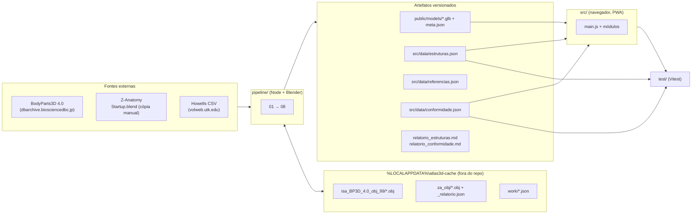
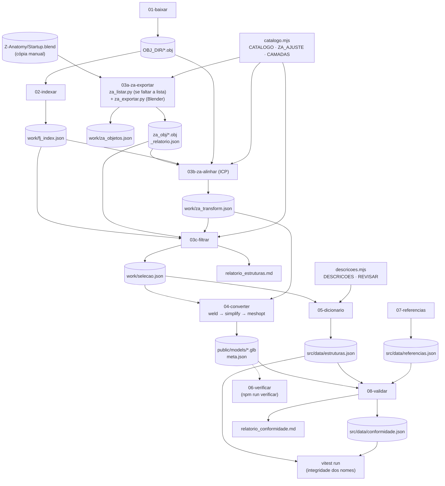
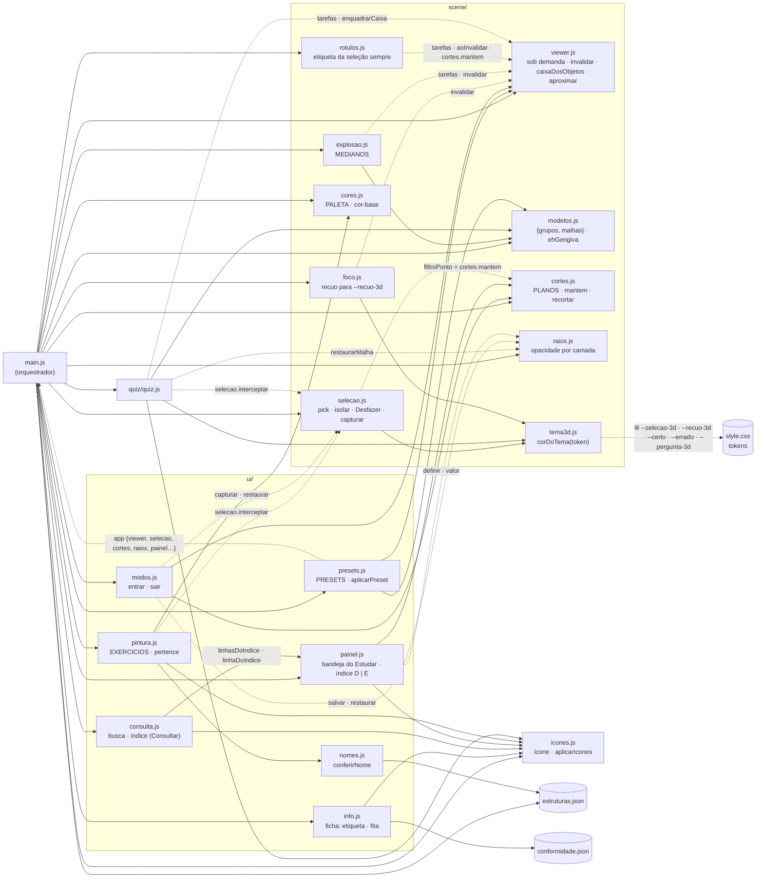
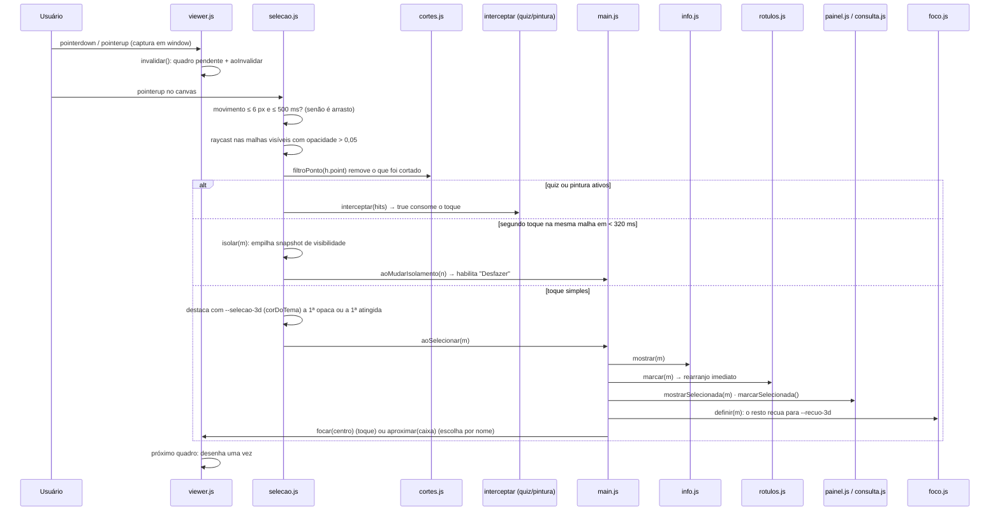
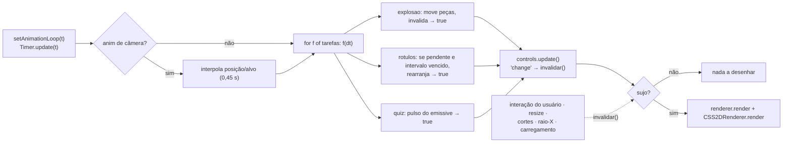
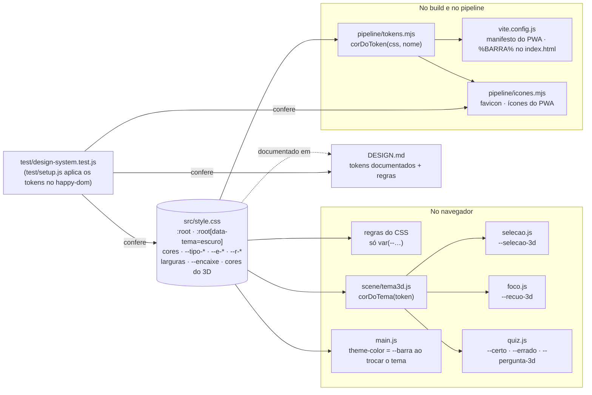

# Arquitetura do Atlas Cabeça e Pescoço

Mapa das relações entre módulos (PWA estático, JavaScript puro, pipeline Node + Blender). Levantamento inicial em 2026-10-06 por leitura de todo o `src/` e dos pontos de leitura e escrita do `pipeline/`; os diagramas refletem o código atual. A seção 8 resume testes, pendências e decisões em vigor; o histórico de cada mudança está no git. A seção 7 descreve o design system ("Bandeja Clínica", que substituiu a "Prancha Anotada" na refundação da interface): de onde vêm os tokens, quem os consome e o que garante que nada saia dele.

## 1. Visão geral: duas metades ligadas por artefatos

O app nunca lê as fontes: ele só consome o que o pipeline publica em `public/models/` e `src/data/`. Os testes (`test/`) leem os mesmos artefatos e falham se o código citar uma estrutura que o pipeline deixou de gerar.

## 2. Pipeline: quem grava e quem lê cada arquivo

A ordem dos nomes é a ordem de execução do `npm run pipeline`, que termina rodando os testes. O único passo manual é copiar a pasta `Z-Anatomy` para o cache; o `za_listar.py` roda sozinho na primeira execução do 03a.

## 3. App: dependências entre módulos

`main.js` é o único ponto que conhece todos os módulos. As setas sólidas são `import`; as tracejadas são dependências injetadas por `main.js` (parâmetros e callbacks). `util.js` é importado por quase todos e foi omitido das setas. `icones.js` (ícones Lucide) e `scene/tema3d.js` (cores do 3D lidas dos tokens) são as duas pontes entre o código e o design system.

Contratos compartilhados que não aparecem nos imports:

| Contrato | Quem escreve | Quem depende |
|---|---|---|
| `mesh.userData.{id, camada, info, base}` | `prepararMalha` em `modelos.js` | todos os módulos de cena, UI e quiz |
| `material.userData.cor` (cor-base atual) | `cores.js` | `quiz.js` (restaura), `foco.js` (recuo parte dela e volta a ela), `painel.js` (bolinha de cor) |
| `material.userData.corOriginal` | `cores.js` | `painel.js` |
| `material.emissive` / `material.color` (destaque) | `selecao.js`, `quiz.js`, `foco.js` (só `color`), sempre com a cor de um token via `corDoTema` | todos voltam de `material.userData.cor`; `foco.reaplicar()` refaz o recuo quando a cor-base muda |
| `material.opacity/transparent/depthWrite` | `raiox.js` (`aplicarOpacidade`) e o fantasma de `quiz.js` | `selecao.js`, `rotulos.js` (opacas ≥ 0,5) |
| `viewer.tarefas` (por quadro; `true` = redesenhar) | `explosao.js`, `rotulos.js` (arranjo quando a cena aquieta), `quiz.js` (pulso de ~3,5 s), `viewer.js` (deslocamento da imagem) | laço de `viewer.js` |
| `viewer.invalidar` / `viewer.aoInvalidar` | interações, controles, resize, `cortes.js`, `explosao.js`, `raiox.js`, `rotulos.js` | `rotulos.js` (rearranjo), laço de `viewer.js` |
| `selecao.interceptar` (consome o toque) | `quiz.js`, `pintura.js` | `selecao.js` |
| tokens do design system (`--*` em `:root`) | `src/style.css` (fonte única) | regras do CSS, `tema3d.js`, `pipeline/tokens.mjs` (ícones e manifesto), `main.js` (`theme-color`); conferidos em `test/design-system.test.js` |
| nomes em inglês `info.en` (sem lado) | `catalogo.mjs` → `estruturas.json` | `presets.js`, `pintura.js`, `explosao.js`, `ehGengiva`; conferidos em `test/integridade.test.js` |

## 4. Fluxo de um toque na cena

## 5. Modos de uso e restauração de estado

```mermaid
stateDiagram-v2
  [*] --> Livre
  note right of Livre : abas Consultar · Estudar · Treinar (definirModo). Sair do Treinar encerra quiz e exercício; sair do Estudar fecha o pincel.
  Livre --> Quiz: bt-quiz no Treinar (sai da pintura)
  Livre --> PincelLivre: Pintar
  Livre --> Exercicio: exercício de pintura
  PincelLivre --> Exercicio: abrir outro (sai do atual)
  Exercicio --> Quiz: bt-quiz → modos.sair() e depois modos.entrar()
  Quiz --> Exercicio: exercício → modos.sair() e depois modos.entrar()
  Quiz --> Livre: sair → modos.sair()
  Exercicio --> Livre: sair → cores restauradas + modos.sair()
  PincelLivre --> Livre: sair (nada a restaurar)
  Livre --> Livre: roteiro → selecao.salvar() + aplicarPreset (desfazível)
```

O que cada modo salva e restaura (tudo em `ui/modos.js`, exceto as cores):

| Estado | Quiz | Exercício | Roteiro |
|---|---|---|---|
| Visibilidade | `selecao.capturar/restaurar` | `selecao.capturar/restaurar` | pilha do Desfazer |
| Opacidade (raio-X) | `raiox.salvar/restaurar` | `raiox.salvar/restaurar` | substitui |
| Cortes | salvos e restaurados | salvos e restaurados | substitui |
| Cores e pintura | não mexe | `cores.iniciarTemporario()` | não mexe |
| Rótulos | desliga e religa ao sair | não mexe | não mexe |
| Câmera | `viewer.destino/voltarPara` | `viewer.destino/voltarPara` | enquadra (não volta) |

O foco por nome também mexe na opacidade, mas só das estruturas que cobrem a peça (`raiox.recuar`, sem tocar no valor das camadas); qualquer nova seleção, ou nenhuma, começa com `raiox.soltar()`, e entrar num modo passa por `selecionar(null)` antes de `raiox.salvar()`.

## 6. Laço de renderização (sob demanda)

## 7. Design system: a Bandeja Clínica

O modelo 3D fica sobre o campo cirúrgico verde-azulado; as ferramentas ficam em bandejas de aço claro com compartimentos; nomes vão em etiqueta de rotuladora; a conferência em livro-texto vai na fita de autoclave (listrada = conferido, lisa = a conferir); um único tom de ação, o azul da luva de nitrilo. A interação assinatura é o foco (`scene/foco.js` + `viewer.aproximar`).

O visual inteiro sai de uma única fonte, os tokens em `src/style.css` (`:root` para o tema claro, `:root[data-tema="escuro"]` para o plantão noturno). Nenhum outro arquivo escreve cor, tamanho de fonte ou espaço: o CSS das regras usa `var(--…)`, o JavaScript do 3D lê os tokens com `corDoTema`, e os scripts de build leem o próprio CSS. O [DESIGN.md](DESIGN.md) documenta os tokens e as regras de uso; os testes falham se código e documentação divergirem.

Estrutura da página (`index.html`): `header.barra` (marca, abas de modo `role="tablist"`, tema) · `aside#bandeja` (alça no celular + um `section[role="tabpanel"]` por modo) · `main#vista` (canvas, régua de vistas, barra inferior com Câmera, Desfazer e Mostrar ocultas) · `aside#lateral` (ficha e sessões; só existe com algo aberto) · `footer.creditos`. Desktop (≥ 1024 px): três colunas, bandeja | vista | lateral. Tablet: bandeja | vista, com a lateral descendo sobre o canto da vista. Celular (≤ 760 px): barra em duas linhas; bandeja e lateral são folhas inferiores, e a lateral ocupa o lugar da bandeja quando aberta. No Treinar com sessão ativa, a bandeja sai e a vista domina.

| Grupo de tokens | Tokens | Uso |
|---|---|---|
| Aço e campo | `--barra`, `--aco`, `--aco-2`, `--aco-borda`, `--aco-forte`, `--campo-luz`, `--campo-borda`, `--campo` | barra, bandejas, compartimentos, divisórias; o campo sob o modelo |
| Tinta | `--tinta`, `--tinta-2`, `--tinta-3` | texto, secundário, desabilitado e placeholder |
| Ação | `--acao`, `--acao-forte`, `--sobre-acao`, `--acao-suave` | ação primária, seleção, foco do teclado, controles marcados |
| Mundo | `--fita`, `--fita-faixa`, `--fita-texto`, `--etiqueta`, `--etiqueta-texto` | fita de autoclave; etiqueta de rotuladora (nome, aba e vista ativas, rótulos 3D) |
| Semânticas | `--certo`, `--errado`, `--aviso`, `--marca-texto` | correção no quiz e na pintura, aviso de dimensões, seleção de texto |
| 3D | `--selecao-3d`, `--recuo-3d`, `--pergunta-3d` (e `--certo`/`--errado`) | emissão e recuo no modelo, lidas por `corDoTema` |
| Tipografia | `--t-1..3`, `--t-campo`; `--tipo-marca`, `--tipo-aba`, `--tipo-secao`, `--tipo-etiqueta`, `--tipo-rotulo`, `--tipo-vista`, `--tipo-nome` (Barlow Condensed 600, caixa alta) e `--tipo-titulo`, `--tipo-latim`, `--tipo-leitura`, `--tipo-lista` (Atkinson Hyperlegible Next) | cada papel é uma fonte completa |
| Espaço e layout | `--e-fino`, `--e-1`, `--e-grupo`, `--e-2..6`, `--largura-bandeja`, `--largura-lateral`, `--botao-fechar`, `--marca-controle`, `--icone`, `--icone-texto` | ritmo e colunas; o celular só redefine tokens |
| Forma, sombra e movimento | `--r-1..4`, `--sombra-1`, `--sombra-2`, `--sombra-folha`, `--vinco`, `--encaixe`, `--rapido`, `--chamada` | cantos, compartimento estampado, folhas do celular, o encaixe da ficha, a chamada dos rótulos |

O que garante que o sistema continue inteiro:

- **`test/design-system.test.js`** (11 testes): toda cor do DESIGN.md existe no CSS com o mesmo valor, nos dois temas; regras do CSS sem cor, fonte ou espaço soltos; nenhum hex no JS do app (exceto a paleta de pintura e as luzes da cena); `corDoTema` lê o valor real e falha com token ausente; os exercícios usam só tintas da paleta; ícones, `index.html` e manifesto usam os tokens.
- **`test/bandeja.test.js`**: as regras de comportamento da direção (pares D | E, ordem FDI, etiqueta e fita na ficha, foco, etiqueta 3D da seleção, rótulos fora da lateral e dentro da vista).

Exceções registradas, que não são tokens por natureza: fios de 1 px; geometria de desenho (ponto da linha de chamada, recuo da régua igual ao raio do cursor nativo, faixa listrada da fita, pega da alça, ajuste de linha de base de ícone); luzes da cena 3D (iluminação, não cor do sistema); a paleta de pintura (`PALETA`), que é conteúdo do estudante, salvo no aparelho, e não cor de interface.

## 8. Testes, pendências e decisões

### Testes e cobertura

`npm run cobertura`: 269 testes; linhas 99,9%, funções 99,5%, instruções 99%, ramos 94,1% (sem `main.js`, que é a composição da página e se verifica no navegador; os ramos variam alguns décimos entre execuções porque o quiz embaralha as perguntas). Os ramos restantes são, na maioria, defensivos (`?.`, valores padrão). O mesmo conjunto roda a cada envio para a `main`, antes da publicação no GitHub Pages.

### Pendências que exigem trabalho manual

- 14 estruturas marcadas "a conferir" esperam conferência em livro-texto; enquanto isso ficam fora do quiz e dos exercícios.
- 23 estruturas do catálogo não existem nas fontes de modelos (BodyParts3D e Z-Anatomy, incluindo a exportação mais recente do Z-Anatomy). A candidata a completá-las é o Open3DModel (CC BY-SA 4.0, mesma linhagem), cuja parte de cabeça e pescoço ainda não foi publicada.
- O pipeline completo exige o Blender (etapa 03a); `npm run dicionario` regera nomes e descrições sem ele.

### Fora do escopo ou não recomendado

- **Guardar normais nos GLB** para evitar `computeVertexNormals` no carregamento (`prepararMalha`): o `weld` seria desfeito e os arquivos ficariam maiores.
- **BVH para raycast** (`three-mesh-bvh`): o pick é por toque e 314 malhas não justificam dependência nova; o custo dos rótulos já é resolvido pelo rearranjo sob demanda e pela criação dos rótulos só quando precisam aparecer.