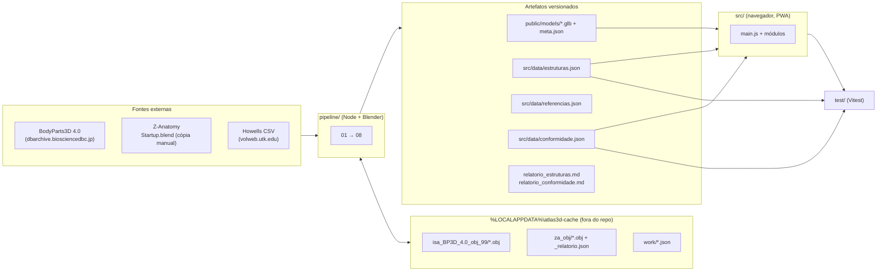
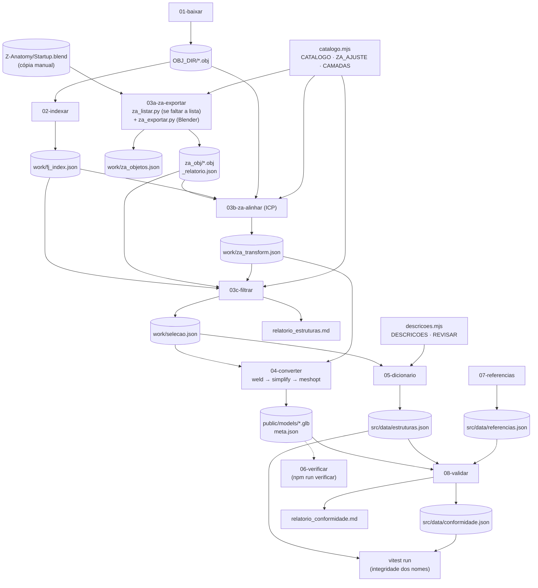
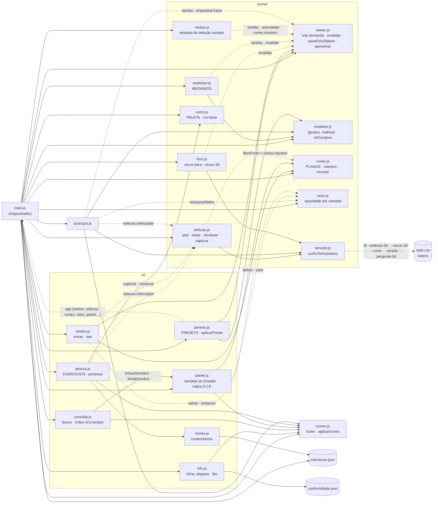
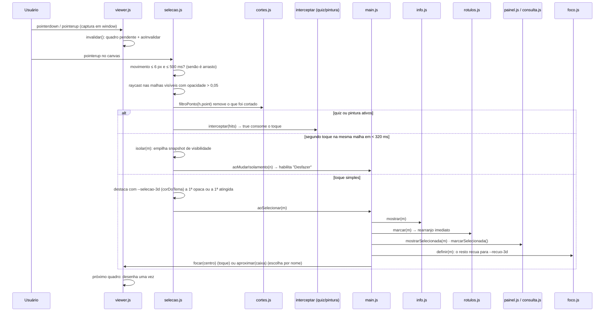
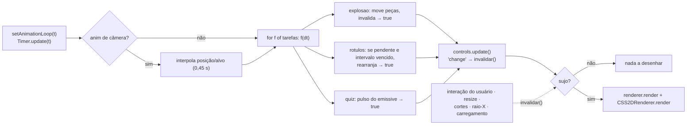
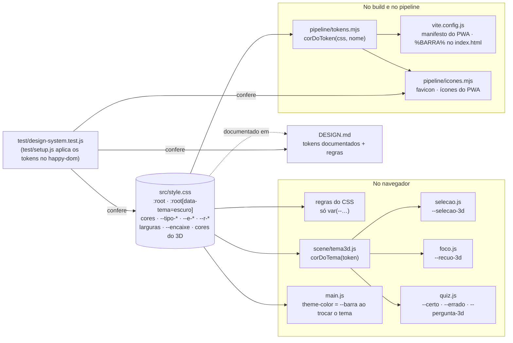

# Arquitetura do Atlas Cabeça e Pescoço

Mapa das relações entre módulos (PWA estático, JavaScript puro, pipeline Node + Blender). Levantamento inicial em 2026-10-06 por leitura de todo o `src/` e dos pontos de leitura e escrita do `pipeline/`; os diagramas refletem o código depois da implementação das melhorias da seção 8, que registra o que mudou em cada item. A seção 7 descreve o design system ("Bandeja Clínica", que substituiu a "Prancha Anotada" na refundação da interface): de onde vêm os tokens, quem os consome e o que garante que nada saia dele.

## 1. Visão geral: duas metades ligadas por artefatos

O app nunca lê as fontes: ele só consome o que o pipeline publica em `public/models/` e `src/data/`. Os testes (`test/`) leem os mesmos artefatos e falham se o código citar uma estrutura que o pipeline deixou de gerar.

## 2. Pipeline: quem grava e quem lê cada arquivo

A ordem dos nomes é a ordem de execução do `npm run pipeline`, que termina rodando os testes. O único passo manual é copiar a pasta `Z-Anatomy` para o cache; o `za_listar.py` roda sozinho na primeira execução do 03a.

## 3. App: dependências entre módulos

`main.js` é o único ponto que conhece todos os módulos. As setas sólidas são `import`; as tracejadas são dependências injetadas por `main.js` (parâmetros e callbacks). `util.js` é importado por quase todos e foi omitido das setas. `icones.js` (ícones Lucide) e `scene/tema3d.js` (cores do 3D lidas dos tokens) são as duas pontes entre o código e o design system.

Contratos compartilhados que não aparecem nos imports:

| Contrato | Quem escreve | Quem depende |
|---|---|---|
| `mesh.userData.{id, camada, info, base}` | `prepararMalha` em `modelos.js` | todos os módulos de cena, UI e quiz |
| `material.userData.cor` (cor-base atual) | `cores.js` | `quiz.js` (restaura), `foco.js` (recuo parte dela e volta a ela), `painel.js` (bolinha de cor) |
| `material.userData.corOriginal` | `cores.js` | `painel.js` |
| `material.emissive` / `material.color` (destaque) | `selecao.js`, `quiz.js`, `foco.js` (só `color`), sempre com a cor de um token via `corDoTema` | todos voltam de `material.userData.cor`; `foco.reaplicar()` refaz o recuo quando a cor-base muda |
| `material.opacity/transparent/depthWrite` | `raiox.js` (`aplicarOpacidade`) e o fantasma de `quiz.js` | `selecao.js`, `rotulos.js` (opacas ≥ 0,5) |
| `viewer.tarefas` (por quadro; `true` = redesenhar) | `explosao.js`, `rotulos.js`, `quiz.js` | laço de `viewer.js` |
| `viewer.invalidar` / `viewer.aoInvalidar` | interações, controles, resize, `cortes.js`, `explosao.js`, `raiox.js`, `rotulos.js` | `rotulos.js` (rearranjo), laço de `viewer.js` |
| `selecao.interceptar` (consome o toque) | `quiz.js`, `pintura.js` | `selecao.js` |
| tokens do design system (`--*` em `:root`) | `src/style.css` (fonte única) | regras do CSS, `tema3d.js`, `pipeline/tokens.mjs` (ícones e manifesto), `main.js` (`theme-color`); conferidos em `test/design-system.test.js` |
| nomes em inglês `info.en` (sem lado) | `catalogo.mjs` → `estruturas.json` | `presets.js`, `pintura.js`, `explosao.js`, `ehGengiva`; conferidos em `test/integridade.test.js` |

## 4. Fluxo de um toque na cena

## 5. Modos de uso e restauração de estado

```mermaid
stateDiagram-v2
  [*] --> Livre
  note right of Livre : abas Consultar · Estudar · Treinar (definirModo). Sair do Treinar encerra quiz e exercício; sair do Estudar fecha o pincel.
  Livre --> Quiz: bt-quiz no Treinar (sai da pintura)
  Livre --> PincelLivre: Pintar
  Livre --> Exercicio: exercício de pintura
  PincelLivre --> Exercicio: abrir outro (sai do atual)
  Exercicio --> Quiz: bt-quiz → modos.sair() e depois modos.entrar()
  Quiz --> Exercicio: exercício → modos.sair() e depois modos.entrar()
  Quiz --> Livre: sair → modos.sair()
  Exercicio --> Livre: sair → cores restauradas + modos.sair()
  PincelLivre --> Livre: sair (nada a restaurar)
  Livre --> Livre: roteiro → selecao.salvar() + aplicarPreset (desfazível)
```

O que cada modo salva e restaura (tudo em `ui/modos.js`, exceto as cores):

| Estado | Quiz | Exercício | Roteiro |
|---|---|---|---|
| Visibilidade | `selecao.capturar/restaurar` | `selecao.capturar/restaurar` | pilha do Desfazer |
| Opacidade (raio-X) | `raiox.salvar/restaurar` | `raiox.salvar/restaurar` | substitui |
| Cortes | salvos e restaurados | salvos e restaurados | substitui |
| Cores e pintura | não mexe | `cores.iniciarTemporario()` | não mexe |
| Rótulos | desliga e religa ao sair | não mexe | não mexe |

## 6. Laço de renderização (sob demanda)

## 7. Design system: a Bandeja Clínica

O modelo 3D fica sobre o campo cirúrgico verde-azulado; as ferramentas ficam em bandejas de aço claro com compartimentos; nomes vão em etiqueta de rotuladora; a conferência em livro-texto vai na fita de autoclave (listrada = conferido, lisa = a conferir); um único tom de ação, o azul da luva de nitrilo. A interação assinatura é o foco (`scene/foco.js` + `viewer.aproximar`).

O visual inteiro sai de uma única fonte, os tokens em `src/style.css` (`:root` para o tema claro, `:root[data-tema="escuro"]` para o plantão noturno). Nenhum outro arquivo escreve cor, tamanho de fonte ou espaço: o CSS das regras usa `var(--…)`, o JavaScript do 3D lê os tokens com `corDoTema`, e os scripts de build leem o próprio CSS. O [DESIGN.md](DESIGN.md) documenta os tokens e as regras de uso; os testes falham se código e documentação divergirem.

Estrutura da página (`index.html`): `header.barra` (marca, abas de modo `role="tablist"`, tema) · `aside#bandeja` (alça no celular + um `section[role="tabpanel"]` por modo) · `main#vista` (canvas, régua de vistas, barra inferior com Câmera, Desfazer e Mostrar ocultas) · `aside#lateral` (ficha e sessões; só existe com algo aberto) · `footer.creditos`. Desktop (≥ 1024 px): três colunas, bandeja | vista | lateral. Tablet: bandeja | vista, com a lateral descendo sobre o canto da vista. Celular (≤ 760 px): barra em duas linhas; bandeja e lateral são folhas inferiores, e a lateral ocupa o lugar da bandeja quando aberta. No Treinar com sessão ativa, a bandeja sai e a vista domina.

| Grupo de tokens | Tokens | Uso |
|---|---|---|
| Aço e campo | `--barra`, `--aco`, `--aco-2`, `--aco-borda`, `--aco-forte`, `--campo-luz`, `--campo-borda`, `--campo` | barra, bandejas, compartimentos, divisórias; o campo sob o modelo |
| Tinta | `--tinta`, `--tinta-2`, `--tinta-3` | texto, secundário, desabilitado e placeholder |
| Ação | `--acao`, `--acao-forte`, `--sobre-acao`, `--acao-suave` | ação primária, seleção, foco do teclado, controles marcados |
| Mundo | `--fita`, `--fita-faixa`, `--fita-texto`, `--etiqueta`, `--etiqueta-texto` | fita de autoclave; etiqueta de rotuladora (nome, aba e vista ativas, rótulos 3D) |
| Semânticas | `--certo`, `--errado`, `--aviso`, `--marca-texto` | correção no quiz e na pintura, aviso de dimensões, seleção de texto |
| 3D | `--selecao-3d`, `--recuo-3d`, `--pergunta-3d` (e `--certo`/`--errado`) | emissão e recuo no modelo, lidas por `corDoTema` |
| Tipografia | `--t-1..3`, `--t-campo`; `--tipo-marca`, `--tipo-aba`, `--tipo-secao`, `--tipo-etiqueta`, `--tipo-rotulo`, `--tipo-vista`, `--tipo-nome` (Barlow Condensed 600, caixa alta) e `--tipo-titulo`, `--tipo-latim`, `--tipo-leitura`, `--tipo-lista` (Atkinson Hyperlegible Next) | cada papel é uma fonte completa |
| Espaço e layout | `--e-fino`, `--e-1`, `--e-grupo`, `--e-2..6`, `--largura-bandeja`, `--largura-lateral`, `--botao-fechar`, `--marca-controle`, `--icone`, `--icone-texto` | ritmo e colunas; o celular só redefine tokens |
| Forma, sombra e movimento | `--r-1..4`, `--sombra-1`, `--sombra-2`, `--sombra-folha`, `--vinco`, `--encaixe`, `--rapido`, `--chamada` | cantos, compartimento estampado, folhas do celular, o encaixe da ficha, a chamada dos rótulos |

O que garante que o sistema continue inteiro:

- **`test/design-system.test.js`** (11 testes): toda cor do DESIGN.md existe no CSS com o mesmo valor, nos dois temas; regras do CSS sem cor, fonte ou espaço soltos; nenhum hex no JS do app (exceto a paleta de pintura e as luzes da cena); `corDoTema` lê o valor real e falha com token ausente; os exercícios usam só tintas da paleta; ícones, `index.html` e manifesto usam os tokens.
- **`test/bandeja.test.js`**: as regras de comportamento da direção (pares D | E, ordem FDI, etiqueta e fita na ficha, foco, etiqueta 3D da seleção, rótulos fora da lateral e dentro da vista).

Exceções registradas, que não são tokens por natureza: fios de 1 px; geometria de desenho (ponto da linha de chamada, recuo da régua igual ao raio do cursor nativo, faixa listrada da fita, pega da alça, ajuste de linha de base de ícone); luzes da cena 3D (iluminação, não cor do sistema); a paleta de pintura (`PALETA`), que é conteúdo do estudante, salvo no aparelho, e não cor de interface.

## 8. Melhorias: o que foi feito

Cada item da análise inicial, com a decisão anti-retrabalho aplicada e a verificação.

| # | Item | Decisão | O que mudou | Verificação |
|---|---|---|---|---|
| 1 | Renderização contínua mesmo parada | `ESTENDER_EXISTENTE` | `viewer.js`: flag "suja", `invalidar()`/`aoInvalidar`, tarefas devolvem `true` para redesenhar; interações capturadas em `window` invalidam a cena | `test/viewer.test.js` (parada não desenha; invalidar, interação, tarefa e animação desenham); no navegador, 0 quadros com a cena parada |
| 2 | Rótulos recalculados sem necessidade | `ESTENDER_EXISTENTE` | `rotulos.js` rearranja só quando a cena mudou (`aoInvalidar`), no máximo a cada 0,2 s; lista de opacas só se algum rótulo precisar do teste de oclusão | `test/interacao.test.js` (rótulos) |
| 3 | Bundle único de 812 KB | `ESTENDER_EXISTENTE` | `vite.config.js`: `codeSplitting` separa o three.js; app 151 kB, three.js 662 kB; limite de aviso calibrado para o chunk do three.js | `npm run build` |
| 4 | Pipeline do zero não rodava sozinho | `ESTENDER_EXISTENTE` | `03a` roda `za_listar.py` quando falta `work/za_objetos.json` e para com mensagem clara se faltar o `Startup.blend`; `za_listar.py` restaurado; `03-filtrar` renomeado para `03c-filtrar` (ordem de execução = ordem dos nomes) | `node --check`; README |
| 5 | Nomes em inglês como chave frágil | `ESTENDER_EXISTENTE` | grupos dos exercícios viraram listas `en: [...]` (função só para critério por FDI); `MEDIANOS` exportado; `test/integridade.test.js` confere todos os nomes contra o dicionário; o `npm run pipeline` roda os testes no fim | `npm test` |
| 6 | Raio-X mexido durante pergunta era desfeito | `ISOLAR_EXISTENTE` | opacidade por camada isolada de `main.js` em `scene/raiox.js`; o fantasma do quiz volta com `raiox.restaurarMalha` | teste de regressão em `test/ui.test.js` |
| 7 | Cortes e rótulos perdidos ao sair de quiz/exercício | `ESTENDER_EXISTENTE` | `ui/modos.js` salva e restaura cortes e rótulos junto com visibilidade e raio-X | `test/interacao.test.js` (modos); no navegador, estado idêntico após sair do quiz |
| 8 | "Mostrar tudo" não ligava camadas | renomear | comportamento mantido (camadas são do painel), nome corrigido: botão "Mostrar ocultas" (`#bt-ocultas`) e `selecao.mostrarOcultas()` | `test/interacao.test.js` |
| 9 | Código morto e comentário desatualizado | remover / corrigir | ramo `resultado` do quiz e argumento ignorado removidos; o enquadramento dos roteiros agora respeita os cortes (`cortes.recortar`), como o comentário dizia | `test/interacao.test.js` (roteiros) |
| 10 | Entrar/sair de modo duplicado em `main.js` | `ISOLAR_EXISTENTE` | `ui/modos.js` (`entrar`/`sair`), com captura de visibilidade própria: um "Desfazer" durante o modo não desalinha mais a restauração | `test/interacao.test.js` |
| 11 | Enquadrar o visível duas vezes | `CONSOLIDAR_EXISTENTES` | `caixaDosObjetos` em `viewer.js`, usado por `modos.js` e `presets.js` | testes de modos e roteiros |
| 12 | Utilitários copiados | `CRIAR_NOVO` | `src/util.js` (`esc`, `semAcentos`, `normalizar`, `visivel`, `ehCelular`) substitui 4 cópias de `esc`, 2 de `visivel`, 5 testes de `matchMedia` e 2 normalizações | `test/util.test.js` |
| 13 | Sem testes | `CRIAR_NOVO` | Vitest + happy-dom + cobertura v8; 10 arquivos em `test/`, incluindo a integridade do design system | ver abaixo |

Achados durante a implementação, também corrigidos:

- `THREE.Clock` está obsoleto no three.js 0.186 e gerava aviso no console a cada carregamento: trocado por `THREE.Timer` (ligado à visibilidade da página).
- `07-referencias.mjs` falhava com o cache vazio (não criava a pasta antes de baixar o CSV de Howells).
- `@gltf-transform/cli` era dependência sem uso e trazia 3 vulnerabilidades altas: removida (`npm audit` = 0).
- `renderer.localClippingEnabled` estava ligado sem nenhum plano local (os cortes são globais): removido.

### Correções da auditoria pós-refundação (lote 1)

| Problema | Decisão | O que mudou | Verificação |
|---|---|---|---|
| Busca por número FDI punha outra estrutura primeiro ("12" → Atlas C1) | `ESTENDER_EXISTENTE` | `pontuar` em `ui/consulta.js`: FDI exato primeiro; FMA e id só pelo começo | `ui.test.js` (posição de todos os dentes) |
| Rótulos ligados entregavam a resposta no exercício com nome | `REUTILIZAR_EXISTENTE` | `ocultarRotulos: true` também nos exercícios (`main.js`) | navegador |
| Modo atlas repetia cores entre camadas (deslocamento pelo tamanho do nome) | `ESTENDER_EXISTENTE` | `scene/cores.js`: uma sequência de ângulo áureo para o modelo inteiro; estado salvo validado (modo, hex, ids que existem) | `cena.test.js` (nenhuma cor repetida no modelo real) |
| Enquadramento inicial e "Câmera" cortavam o crânio em retrato | `CONSOLIDAR_EXISTENTES` | `distanciaPara` em `viewer.js` usada por enquadrar, reset, `enquadrarCaixa` e `aproximar`; caixa vazia ignorada; arrastar cancela a animação; movimento reduzido vai direto (câmera e explosão) | `viewer.test.js`, `cena.test.js` |
| Trocar de aba descartava o quiz sem gravar | `ESTENDER_EXISTENTE` | `gravarSessao(parcial)` em `quiz.js`: sair no meio grava erradas e histórico marcado "interrompido" | `ui.test.js` |
| Dado salvo em formato errado travava o quiz | `ESTENDER_EXISTENTE` | `lerDados` valida campo a campo; "Refazer as N" conta só as que ainda valem; foco vai ao título ou à primeira opção a cada pergunta | `ui.test.js` |
| Desfazer depois do modo voltava à cena da sessão | `ESTENDER_EXISTENTE` | `selecao.cortarPilha(n)`; `modos` guarda o nível ao entrar e corta ao sair | `interacao.test.js` |
| Nota do roteiro sumia no celular | `REUTILIZAR_EXISTENTE` | no celular a nota vai para o aviso da vista (`avisar`, com tempo proporcional ao texto) | navegador |

### Correções da auditoria pós-refundação (lote 2: robustez e acessibilidade)

| Problema | Decisão | O que mudou | Verificação |
|---|---|---|---|
| Seleção ficava presa a estrutura invisível (camada desligada); regra repetida em três lugares | `CONSOLIDAR_EXISTENTES` | `selecao.conferir()` único, chamado por `isolar`, `desfazer`, `restaurar` e por `mudou()` em `main.js` | `interacao.test.js` |
| Trocar o tema não relia o brilho da seleção | `ESTENDER_EXISTENTE` | `selecao.redestacar()` junto de `foco.reaplicar()` | `interacao.test.js`, navegador |
| Falha ao carregar um GLB deixava "Carregando…" para sempre | `ESTENDER_EXISTENTE` | `carregarModelos` diz qual camada falhou; `main.js` mostra a mensagem e "Tentar de novo" (`.carregando.falhou`) | `viewer.test.js`, navegador |
| No celular, abas pareciam não responder com a ficha aberta | `ESTENDER_EXISTENTE` | tocar numa aba fecha a ficha (fora de quiz e pintura) e abre a bandeja | navegador |
| "Limpar pintura" do pincel apagava sem confirmar | `CONSOLIDAR_EXISTENTES` | `limparTudo()` único em `pintura.js`, com confirmação nos dois lugares | `ui.test.js` |
| Ficha citava um relatório que o app não entrega; sem Esc nem retorno de foco | `ESTENDER_EXISTENTE` | cita Howells e Kim et al. 2013; Esc (campo de busca vazio) fecha a ficha e devolve o foco à busca | navegador |
| Contraste ~2:1 em estrutura de camada desligada | `ESTENDER_EXISTENTE` | `--tinta-3` + traço pontilhado no lugar de `opacity: 0.5` | navegador |
| `aria-live` em seções inteiras; paleta e régua de vistas sem estado/teclado; camadas sem `aria-controls` | `ESTENDER_EXISTENTE` | live só em `.retorno` e `.contagem`; `aria-pressed` na paleta; setas e uma parada de Tab na régua de vistas; `aria-controls` nas camadas; título do Desfazer corrigido | `ui.test.js`, navegador |
| Primeira seleção varria os vértices do modelo inteiro; camada a 0% ainda era desenhada | `ESTENDER_EXISTENTE` | rótulos criados sob demanda (`criarItem`); `material.visible` abaixo de `INVISIVEL` no raio-X; `raiox.restaurar` avisa uma vez | `bandeja.test.js`, `cena.test.js` |
| Seleção no Consultar abria camadas na bandeja escondida do Estudar | `ESTENDER_EXISTENTE` | `mostrarSelecionada` não abre com o painel oculto; checkboxes guardados num `Map` | `ui.test.js` |

### Evoluções de estudo (lote 3)

| Evolução | Decisão | O que mudou | Verificação |
|---|---|---|---|
| Revisão das estruturas que mais erra | `ESTENDER_EXISTENTE` | `porId[id]` ganhou a data da última resposta (`[acertos, erros, quando]`, compatível com os dados antigos); `revisao()` em `quiz.js` ordena por saldo de erros e, no empate, pela vista há mais tempo; botão "Revisar o que mais erro (N)" e "Você mais erra" saem da mesma lista | `ui.test.js` |
| Ficha ligada aos outros modos | `ESTENDER_EXISTENTE` | `criarInfo` aceita `aoEstudar`/`aoTreinar`: "Ver no índice do Estudar" (troca o modo e abre a camada) e "Quiz de <camada>" (`quiz.abrir({ camadas })`) | `ui.test.js`, navegador |
| Correção de nomes mais justa | `ESTENDER_EXISTENTE` | genérico no plural e em latim pode ser omitido ("maxilares", "Venae …" sem "venae"); duas letras vizinhas trocadas contam como um erro (Damerau restrito) | `nomes.test.js` |
| Etiqueta 3D não distinguia "a conferir" | `ESTENDER_EXISTENTE` | `.rotulo.a-conferir` usa a fita lisa da ficha | `bandeja.test.js` |

Sobre a correção de nomes: omitir o genérico gera formas curtas compartilhadas entre estruturas de camadas diferentes ("frontal" vale para o osso e para o nervo; "facial" para nervo, artéria e veia). Isso já existia antes; o exercício pergunta o nome de uma estrutura específica, então o contexto desambigua.

### Pipeline e dados (lote 4)

| Problema | Decisão | O que mudou | Verificação |
|---|---|---|---|
| Pipeline ia à rede mesmo com o cache completo; downloads sem conferência | `ESTENDER_EXISTENTE` | `01-baixar`: sem rede com o cache completo; download direto para `.part` e renomeado no fim; SHA-256 de cada arquivo em `fontes.json` no cache, conferido nas execuções seguintes; `--tamanhos` consulta o servidor | `node --check` (o cache atual não tem o BodyParts3D; não foi rodado) |
| `06-verificar` imprimia "FALHOU" e saía com sucesso; fora do `npm run pipeline` | `ESTENDER_EXISTENTE` | sai com 1; confere ids únicos, ids iguais aos do dicionário, nós sem aninhamento (hipótese do `prepararMalha`) e orçamento dos GLB (3 MB por arquivo, 12 MB no total); entra no pipeline depois do 05 | rodado: 314 ids, 2,40 MB, OK |
| `08-validar` nunca falhava e apagava o checklist marcado à mão | `ESTENDER_EXISTENTE` | status por item em `conformidade.json`; piora em relação à execução anterior = lista, não grava e sai com 1 (`--aceitar` grava); `[x]` do relatório preservado; data só muda quando o resultado muda | rodado: regressão simulada detectada; checklist preservado; segunda execução sem alteração |
| Corrigir nome/latim/descrição exigia o pipeline inteiro (~1 GB + Blender) | `ISOLAR_EXISTENTE` | `nomeComLado` saiu do 03c para `catalogo.mjs`; o 05 reconstrói a seleção a partir do `estruturas.json` publicado quando falta `work/selecao.json`; `npm run dicionario` | reconstrução byte a byte idêntica ao publicado; `pipeline.test.js` |
| Dicionário desatualizado passava no `npm test` | `ESTENDER_EXISTENTE` | `integridade.test.js` compara cada estrutura com `catalogo.mjs`/`descricoes.mjs`; exercícios não podem ter membro "a conferir" | `integridade.test.js` |
| Erros crus (`ENOENT`, `TypeError`) quando falta uma etapa | `CRIAR_NOVO` (helper de 4 linhas, sem equivalente) | `lerJson(arquivo, etapa)` em `config.mjs`, usado no 03b, 03c e 04 | `pipeline.test.js` |
| Projeto sem controle de versão; Node mínimo não declarado | `CRIAR_NOVO` | `git init` na pasta do projeto, `.gitignore` (gerados, junções e estado local) e `.gitattributes` (LF; binários); `engines` no `package.json` (o do Vite 8) | `git status`: 88 arquivos, 3,4 MB, nenhum commit ainda |

Pendente e fora do alcance dos scripts (exige trabalho manual): a fonte bibliográfica de cada uma das 152 descrições (o pipeline não tem o campo e nenhuma descrição cita livro-texto); a conferência das 14 estruturas marcadas "a conferir"; e as 23 estruturas do catálogo que não existem nas fontes de modelos.

### Testes e cobertura

`npm run cobertura`: 252 testes; linhas 99,7%, funções 99,1%, instruções 98,8%, ramos 94,2% (sem `main.js`, que é a composição da página e se verifica no navegador; os ramos variam alguns décimos entre execuções porque o quiz embaralha as perguntas). Depois da refundação da interface, `consulta.js` (busca, ranking, teclado), `foco.js`, `viewer.aproximar`, os carimbos e o Raio-X do quiz e a etiqueta 3D da seleção ganharam testes próprios; os ramos restantes são, na maioria, defensivos (`?.`, valores padrão).

### Fora do escopo ou não recomendado

- **Guardar normais nos GLB** para evitar `computeVertexNormals` no carregamento (`prepararMalha`): o `weld` seria desfeito e os arquivos ficariam maiores. Mantido.
- **BVH para raycast** (`three-mesh-bvh`): o pick é por toque, 314 malhas não justificam dependência nova, e o custo dos rótulos foi resolvido no item 2.
